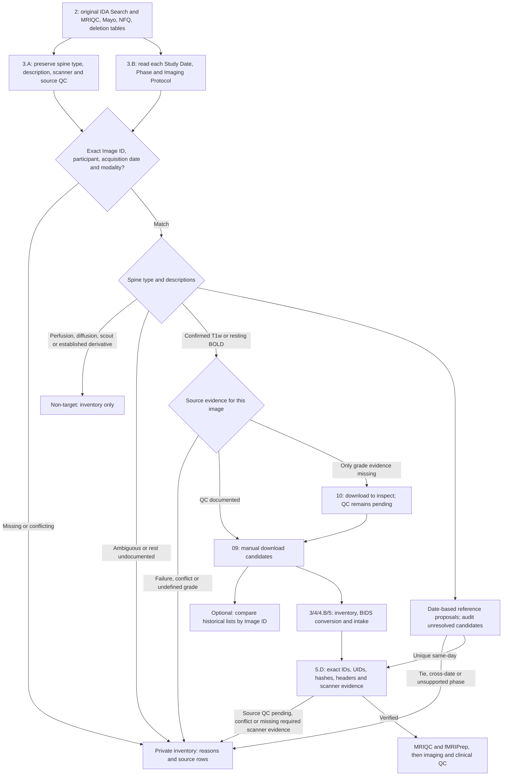

# Date-based EPI and T1 reference selection

Scientific references here are restricted to ADNI official answers and research papers. The [complete stage evidence register](../../docs/stage_evidence.md) records answer IDs/dates, paper DOIs/sections, and which decisions remain project policies.

Stage 3.B inventories images by participant, actual acquisition date, Image ID and source QC. Visit codes remain provenance. The objective is to retain the available evidence and propose an auditable anatomical reference for every EPI, before any image is approved for preprocessing.

## Workflow and decision boundaries

Metadata exports and source QC can be reviewed before a large imaging download. If images have already been downloaded, 3.B can instead reconcile that inventory. Neither route changes original source tables. The metadata stage writes only external artifacts and never invokes a downloader, dcm2niix, MRIQC or fMRIPrep.

The [3.B example configuration](../config/image_selection.example.json) accepts explicit collection files, their search modalities and per-row phases, the 3.A output directory and a new output directory. Source QC is linked through `artifact.json` and `image_qc.tsv`. Collection identity conflicts remain blocked, unverified quality remains pending, and the output receipt binds all artifacts for later verification.

## Selection checkpoints and their evidence

| Checkpoint | What is checked | Basis and limits |
|---|---|---|
| 2 / 3.A: source identity | Read the MRIQC Study Files spine, including original series type, description and scanner; join source quality, NFQ and known failures independently. | [ADNI Image ID correspondence (A10)](../../docs/stage_evidence.md#a10) and [grade/chosen answers (A05/A09)](../../docs/stage_evidence.md#stage-3-a). The four-key intersection is the Research workflow, not an ADNI grading recommendation. |
| 3.B: dates and phase | Use IDA **Study Date** and per-row **Phase**. The MRI protocol phase is a separate observation. Never substitute Archive Date, VISCODE or a visit label. | [ADNI QID 434](https://adni.loni.usc.edu/support/experts-knowledge-base/question/?QID=434) discusses anatomical acquisition dates; [QID 2126](https://adni.loni.usc.edu/support/experts-knowledge-base/question/?QID=2126) distinguishes visit codes from elapsed time. CSV aliases and mixed-file checks are implementation rules. |
| 3.B: series and download | Require source T1w or source BOLD with positive resting evidence and no contrary description. Exclude perfusion/diffusion, scouts and confirmed MoCoSeries. Ambiguous names stay in review. Exact identity and absence of a blocking finding are required. Confirmed targets missing only grade evidence may be downloaded for inspection; execution still requires passing source QC. | [Arani et al., §§2.6–2.8 and Table 1](https://doi.org/10.1002/alz.14162) distinguish ASL, diffusion and task-free EPI-BOLD. The text rules, positive confirmation and pre-download QC gate are project safeguards. |
| 3.B / 5.D: scanner | Compare Search protocol and spine information on each image. Compare independent BIDS metadata to source and across the proposed pair; known conflict holds, absent model stays unknown, missing physical manufacturer or strength holds. | [Arani et al., §2.8](https://doi.org/10.1002/alz.14162) describe scanner/protocol variation; [Gorgolewski et al., BIDS metadata](https://doi.org/10.1038/sdata.2016.44) describe metadata representation. Neither paper prescribes these hold rules. |
| Private reconciliation | Compare both historical Search/QC lists to the actual download file; classify each ID as retained, added, removed or neither, keeping specific reasons. | An audit of local decisions, not scientific validation. Historical lists are never selection inputs. |

### Reading missing evidence by phase

Use the **search phase** to count images; use the **MRI protocol phase** to interpret them. GO and 2 share a protocol label in some tables. A GO/ADNI1 or ADNI3/GO–2 discrepancy remains a separate review hold. Analyze increments in Image IDs, not in people, sessions or completed preprocessing runs.

| Source and scope | What a linked row establishes | How to read an absence |
|---|---|---|
| Research QC1 MRIQC spine plus the matching Search row | Same target acquisition by ID, participant, acquisition date and modality; the spine has no Mayo quality grade. | Recover the positively identified image for QC inspection. A historical download ID does not imply QC pass. |
| GO/2 or ADNI3 Mayo series QC | Recognized series grade on the particular image; QC2 selection and series quality are separate. | Inspect the actual date coverage of the supplied snapshot and look for the source assessment. No record in that extract is not a failed scan. [ADNI QID 89](https://adni.loni.usc.edu/support/experts-knowledge-base/question/?QID=89) explains historical T1 grades. |
| GO/2/3 NFQ | Matched overall quality if reported. Functional measures and slice timing are separate from that field. | Distinguish no unique row from a blank or unrecognized grade on a matched row. Do not infer a match by visit or day alone. [ADNI QID 1822](https://adni.loni.usc.edu/support/experts-knowledge-base/question/?QID=1822) identifies the GO/2/3 deliverable; it does not mandate a two-table pass for downloading. |
| ADNI4 NFQ and ARC | If a supplied NFQ schema has no `OVERALLQC`, even an exact ID+UID does not establish a functional QC grade. | [ADNI QID 2541](https://adni.loni.usc.edu/support/experts-knowledge-base/question/?QID=2541) limits the pass-and-chosen statement to ARC Builder. Do not attribute that provenance to an ordinary mixed Search export; recover image-specific ARC evidence separately. |

These are project rules for retrieval and traceability. Neither ADNI nor [Arani et al., §2.8](https://doi.org/10.1002/alz.14162) establish that missing grades certify preprocessing readiness. The download-for-review list never overrides source QC at 5.D.

## Three different dates and identities

| Evidence | Role |
|---|---|
| EPI acquisition date | The functional observation's actual imaging date |
| T1 acquisition date | The anatomy's actual imaging date; retained separately with a signed EPI–T1 gap |
| Clinical assessment date | Used later to attach clinical information to the imaging observation |
| VISCODE/visit label | Source provenance; never substituted for an acquisition date |
| Image ID and series UID | Identify the actual acquisition or delivered image, beyond its date/visit label |

The clinical nearest/28-day policy belongs to 9.A/9.B. It is not an EPI–T1 pairing window. A T1 that lacks an eligible clinical assessment can still be inventoried as an anatomical reference candidate; its image quality and registration suitability require their own assessment. Conversely, a source-QC pass does not establish clinical eligibility or final analysis readiness.

## Project policy implemented by 3.B

Every raw search row remains in the inventory. Identified non-target series do not enter the pairing manifest. Other EPI search candidates retain their review state; unresolved T1s cannot authorize a reference. Links are generated only within the same participant. Known source failures cannot become eligible references, and missing source evidence is never promoted to a pass.

Eligible same-day candidates take precedence. Within that set, priority is documented source QC, Mayo-selected status, then quality grade. If no eligible same-day candidate exists, cross-date priority is documented QC, absolute acquisition-date gap, Mayo selection, then grade. Acceleration is recorded without a preference. All equally ranked top candidates are retained; the code does not break ties using Image ID, row order or the latest date.

The cross-date review window defaults to `null`, meaning all supplied dates are visible for review. A positive integer restricts the reviewed candidate set without deleting other links. Neither choice enables automatic cross-date processing. Future anatomy receives an explicit timepoint-review flag, and phase/manufacturer/scanner/field-strength differences are recorded when metadata are available. A unique proposal may therefore still require review.

This ordering is an explicit project adaptation of the documented Research selection policy. It is not claimed to be the universally optimal anatomical-reference method, an exact replay of all historical Research outputs, or a new clinical exclusion rule. The policy file records the exact choices used in each run.

## Conversion and exact binding

The earlier Clinica workflow described ADNI conversion and selection among available acquisitions; the ADNI protocol preprint reports conversion/selection issues. Neither paper guarantees that every proposed Image ID survives the installed converter. Our [direct dcm2niix converter](../../02-bids/dcm2niix/README.md) records one outcome for every selected Image ID. [Routier et al. (2021), ADNI conversion section](https://doi.org/10.3389/fninf.2021.689675); [Rutherford et al. (2026), Step 4, preprint](https://doi.org/10.21203/rs.3.rs-11132707/v1).

Reconcile the source inventory with conversion records and the actual BIDS files. Step 5.D consumes `00.candidate-images.csv`, `04.epi-analysis-manifest.csv` and `07.run-manifest.json`, together with independently established Image ID/date/modality-to-NIfTI-hash evidence. It verifies exact UIDs, participant identity, dates, file hashes and headers before preparing a pair. A proposed image that is absent, ambiguous or inconsistent stays held; another scan with the same VISCODE is not a substitute.

The current guarded runner still accepts only an eligible, resolved same-day proposal in the reviewed GO/2/3 scope. Cross-date inventory does not create an executable cross-date adapter. Recovering images omitted by a converter, changing the anatomical reference mode or supporting a different phase requires a separately reviewed conversion/execution extension. Keep original dates and provenance intact.

## Evidence and its limits

| Source and exact location | What it supports | What remains a project decision |
|---|---|---|
| [ADNI QID 2126](https://adni.loni.usc.edu/support/experts-knowledge-base/question/?QID=2126), Monica E., 2025-02-27 | Scheduled visit codes differ from actual elapsed time | Preserve every acquisition and verify exact image identities |
| [ADNI QID 434](https://adni.loni.usc.edu/support/experts-knowledge-base/question/?QID=434), MRI Core, 2015-02-20 | Select anatomy by acquisition date; adjacent-time T1/T2 can be considered after QC failure | Same-day automatic eligibility, cross-date review holds and the absence of an automatically accepted gap |
| [ADNI QID 89](https://adni.loni.usc.edu/support/experts-knowledge-base/question/?QID=89), Borowski, 2013-10-24/29; [QID 454](https://adni.loni.usc.edu/support/experts-knowledge-base/question/?QID=454), MRI Core, 2015-04-07 | Historical repeated T1, quality grades and chosen-series decisions | Combined QC/chosen/grade priority, no Image-ID tie-break and no acceleration preference |
| [ADNI QID 2401](https://adni.loni.usc.edu/support/experts-knowledge-base/question/?QID=2401), Danielle, 2026-02-09 | Nearest diagnosis within a researcher-defined interval | The 28-day clinical window and its independence from the anatomical reference pool |
| [Rutherford et al. (2026)](https://doi.org/10.21203/rs.3.rs-11132707/v1), Results and Step 9 | Same-session anatomy in that implementation; actual-date clinical linkage with default 180 days | Our stricter exact-image gate, different clinical policy and cross-date candidate inventory |
| [Arani et al. (2024)](https://doi.org/10.1002/alz.14162), §2.8 | MRI protocol variation across phase/scanner, including ADNI4 | Holding unsupported phases until their conversion/QC/execution paths are reviewed |

Rutherford et al. is a Research Square **preprint**, October 6, 2026, version 1; it has not been peer reviewed. Its settings describe one protocol. In particular, its clinical linkage flags unmatched visits; it is not evidence for this project's hard 28-day clinical gate.

ADNI QID 434 permits considering adjacent-time anatomy; it does not require every T1/EPI pair to be same-day. Our same-day-only automatic path is a conservative execution policy. No reviewed source establishes a universally acceptable maximum gap. Future anatomy is flagged because study-timepoint availability must be decided for the actual research design; this is a project safeguard, not a newly claimed ADNI prohibition.

## Related preprocessing and QC corrections

| Stage | Source and supporting location | Implemented correction and limit |
|---|---|---|
| 4.B | [ADNI QID 1822](https://adni.loni.usc.edu/support/experts-knowledge-base/question/?QID=1822), Mayo ADIR team, 2024-03-06; [Sladky et al. (2011)](https://doi.org/10.1016/j.neuroimage.2011.06.078), STC Methods | NFQ/physical timing requires correct acquisition identity. Our series/UID/date checks and ambiguity holds are engineering safeguards; the paper does not validate this repair adapter. |
| 6/S8/S10 | [Esteban et al. (2017)](https://doi.org/10.1371/journal.pone.0184661), IQMs and visual reports; [Power et al. (2014)](https://doi.org/10.1016/j.neuroimage.2013.08.048), FD methods | Missing/nonfinite QC remains unresolved, later missing FD is not filled with zero, and TSV is read correctly. These are data-integrity corrections, not literature-derived acceptance thresholds. |
| S10 initial volumes | [Mehta et al. (2024)](https://doi.org/10.1162/imag_a_00257), §2.6 | The paper describes optional automatic NSS removal from fMRIPrep flags. Enabling it and verifying output frame counts are our implementation policy; 36P regression does not itself perform that removal. |
| S8/S10 anatomy | [Rosen et al. (2018)](https://doi.org/10.1016/j.neuroimage.2017.12.059), quality measures and Fig. 5/Tables 3–4 | Evaluate separate reconstructions separately. The participant-balanced site reference, cutoff 5 and minimum 10 are project adaptations, not rules validated in that paper. |
| 7 | [Esteban et al. (2019)](https://doi.org/10.1038/s41592-018-0235-4), Methods/Table 1 | The paper supports fMRIPrep's methods. The current 25.2.7 pin, seed/thread settings and exact-image view are engineering choices; no release-specific bug-fix claim is being justified by this older paper. |
| S10 denoising | [Ciric et al. (2017)](https://doi.org/10.1016/j.neuroimage.2017.03.020), compared models and QC–FC results; [Mehta et al. (2024)](https://doi.org/10.1162/imag_a_00257), §2.13 | 36P/GSR/censoring has method evidence and trade-offs. FD 0.3 mm/240 s are defaults described in the final XCP-D paper, not proven ADNI-optimal thresholds. |

Full parameter comparisons, filtering/regression evidence and operational-stage limits are in the [stage register](../../docs/stage_evidence.md#parameter-and-policy-traceability). Cohort QC–FC, distance dependence, retained duration and group differences still need assessment. Use a fresh runtime and `sessionwise-euler-nss-v1`; existing jobs/results are not migrated by this documentation update.

## Validation scope

Synthetic checks cover date/visit disagreement, multiple EPI runs, all-date T1 preservation, same-day and cross-date ordering, ties, future anatomy, missing/blocked QC, explicit policy limits, receipt tampering and exact BIDS handoff. This verifies code and artifact contracts. It does not process real ADNI images, validate cross-date registration, establish a research cohort or approve final inclusion. All 3.B outputs retain `PREPROCESSING_READY=False` and `ANALYSIS_READY=False`.
