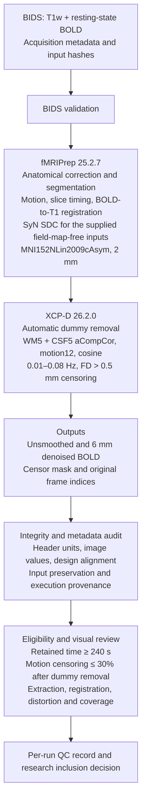

> 보존된 volume 파일럿의 방법 문서입니다. 예시는 합성 식별자로 치환했으며, 최신 36P/LINC 경로의 방법·검증 결과로 사용하지 않습니다.

# 🟥1️⃣ Reporting status

This document describes the configured aCompCor volume protocol. Actual pilot outcomes, acquisition-specific observations and limitations remain in the private archived TEST_RESULTS.md and per-run provenance. Before using this methods draft, reconcile it with the study logs and add cohort counts, exclusions, retained durations and researcher decisions. Preserve each program's generated CITATION.md and bibliography.

# 🟥1️⃣ Pipeline overview

The figure describes the configured workflow. Eligibility and visual review are recorded separately from successful software execution; outputs are retained even if a run is excluded from a later analysis.

# 🟥1️⃣ English methods draft

T1-weighted and resting-state functional MRI data were supplied in Brain Imaging Data Structure (BIDS) format and processed separately for each participant and visit using version-pinned Docker containers. Acquisition-specific metadata, including repetition time (TR), echo time, phase-encoding direction, total readout time and slice timing, were retained. ADNI phase was checked against the corresponding NFQ records. The processing framework was informed by the ADNI-specific workflow of Rutherford et al. (2026, preprint) and the ADNI3 fMRIPrep-to-XCP-D application of Leone et al. (2024), with acquisition differences described by Arani et al. (2024). Wang, Chen and Qiao (2026) provide an additional ADNI3/ADNI4 analysis precedent using GRETNA. The present workflow adapts these precedents and does not reproduce any one of them exactly.

Spatial preprocessing used fMRIPrep 25.2.7 (Esteban et al., 2019), with BIDS validation enabled. Structural processing included intensity nonuniformity correction, brain extraction, tissue segmentation and nonlinear normalization to MNI152NLin2009cAsym space. Functional processing included head-motion estimation, slice-timing correction using the acquisition metadata, BOLD-to-anatomical registration and resampling into standard space at 2-mm isotropic resolution. Each visit used its own anatomical reference; surface reconstruction was disabled. Because the pilot BIDS inputs contained no field maps, anatomy-based SyN susceptibility distortion correction was applied, and its execution was verified in the generated reports. Correction failures were treated as processing errors.

Postprocessing used XCP-D 26.2.0 (Mehta et al., 2024). Initial non-steady-state volumes identified by fMRIPrep were removed automatically. The nuisance model included five aCompCor components from white matter and five from cerebrospinal fluid, the six rigid-body motion parameters and their temporal derivatives, and the corresponding cosine basis terms. Global signal regression and despiking were disabled. Framewise displacement (FD) was calculated without respiratory filtering using a 50-mm head radius, and volumes with FD greater than 0.5 mm were censored. Design matrices, motion traces and censor masks were retained for verification.

Within the selected XCP-D workflow, high-motion samples were interpolated internally for filtering, and the BOLD data and confounds were detrended, centered and temporally filtered at 0.01–0.08 Hz using a Butterworth filter with its order parameter set to two. Nuisance coefficients were estimated from retained low-motion samples, and censored samples were omitted from the final time series. Run-level eligibility required at least 240 seconds of retained data and no more than 30% motion censoring among post-dummy volumes. The 240-second minimum was a project adaptation for shorter ADNI4 acquisitions, specified before full-cohort analysis. Both unsmoothed denoised images and images smoothed with a 6-mm full-width-at-half-maximum Gaussian kernel were retained. Visits were not concatenated, and acquisition TRs were not resampled to a common TR.

Technical quality control checked input-file integrity, image dimensions and units, TR, confound/censor-mask alignment, retained duration, finite image values and successful software execution. Selected reports and image mosaics were inspected for extraction, tissue boundaries, registration, distortion correction, coverage and temporal artifacts. Technical completion and automated motion/duration eligibility were recorded separately from the final research inclusion decision. Original frame indices were preserved alongside censored outputs so that subsequent temporal analyses could account for gaps in sampling.

# 🟥1️⃣ 한국어 설명

- 참가자·방문별 BIDS 입력과 Docker 버전을 고정한 실행 및 원본 읽기 전용 연결
- fMRIPrep에서 해부학 영상 보정·분할, 움직임·slice timing 보정, BOLD–T1 정합, MNI 표준공간 정규화를 수행하도록 설정
- 제공된 테스트 BIDS에 field map이 없어 해부학 영상 기반 SyN 왜곡 보정을 요청하고 실제 적용 기록 검증
- XCP-D에서 초기 비정상 volume 제거, aCompCor·움직임·cosine 회귀, 0.01–0.08 Hz 필터, FD >0.5 mm censoring을 수행하도록 설정
- 보존 시간 240초 이상·초기 제거 후 motion censoring 비율 30% 이하를 분석 적격 기준으로 지정하고 별도 audit에서 판정. 6 mm 평활화 전·후 결과 출력 요청
- 입력 무결성·영상 차원·시간축·실제 회귀변수·보고서의 왜곡 보정 기록 대조
- 실행 성공, 움직임 기준 통과, 시각 QC, 최종 분석 포함 판정의 별도 기록

Report the actual slice-timing reference offset from each run's generated command; do not assume TR/2. Per-visit measured values remain in the private run record.

# 🟥1️⃣ NIfTI metadata verification

The implementation also checks the spatial and temporal units of smoothed outputs against their matching unsmoothed derivatives and JSON repetition time. For the observed missing-unit header produced by the pinned XCP-D workflow, a guarded header-only correction restores the units while preserving the original compressed image and proving that the decompressed voxel payload and spatial transforms are unchanged. This is a file-metadata correction, not an additional signal-processing step. Actual application records remain in the private archive and per-visit correction provenance.

# 🟥1️⃣ Values to report from the completed cohort

| Item | Required final value |
|---|---|
| Participants and visits | ADNI3/ADNI4 counts before and after QC; repeated participants identified |
| Acquisition | TR/TE, voxel size, run duration, multiband factor, site and scanner distributions |
| Input limitations | Missing or unusable field maps, missing metadata, coverage limitations |
| Software | Exact tags and image digests; fMRIPrep and XCP-D generated citations |
| Dummy volumes | Counts and distribution, obtained from actual confounds |
| Motion | FD distributions, censor percentages, retained seconds by group/site/phase |
| Confounds | Actual selected components and design rank; any deviations or missing columns |
| Spatial QC | Reviewer, date, decision and reason for extraction/registration/coverage exclusions |
| Final stream | Unsmoothed or 6-mm smoothed output chosen for the stated analysis endpoint |

Do not claim all ADNI3/ADNI4 subjects were processed based on the pilot. Do not claim ICA-AROMA, field-map correction, FreeSurfer surfaces, GSR, atlas extraction, ComBat harmonization, ALFF or ReHo were used in this implementation. The method comparison and source-specific adaptations are documented in `literature.md`.

# 🟥1️⃣ Core references

- [Esteban et al., 2019 — fMRIPrep](https://doi.org/10.1038/s41592-018-0235-4)
- [Mehta et al., 2024 — XCP-D](https://doi.org/10.1162/imag_a_00257)

- [Wang, Chen & Qiao, 2026 — direct ADNI3/ADNI4 analysis, DOI 10.1016/j.media.2026.104124](https://www.sciencedirect.com/science/article/pii/S1361841526001933)
- [Rutherford et al., 2026 — ADNI preprocessing/QC preprint](https://arxiv.org/abs/2602.03278)
- [Leone et al., 2024 — ADNI3 fMRIPrep/XCP-D application](https://onlinelibrary.wiley.com/doi/full/10.1002/hbm.70081)
- [Arani et al., 2024 — ADNI MR acquisition protocol](https://alz-journals.onlinelibrary.wiley.com/doi/full/10.1002/alz.14162)
- Software and component citations: use the actual fMRIPrep and XCP-D `CITATION.md` and `.bib` files created by the completed run.
