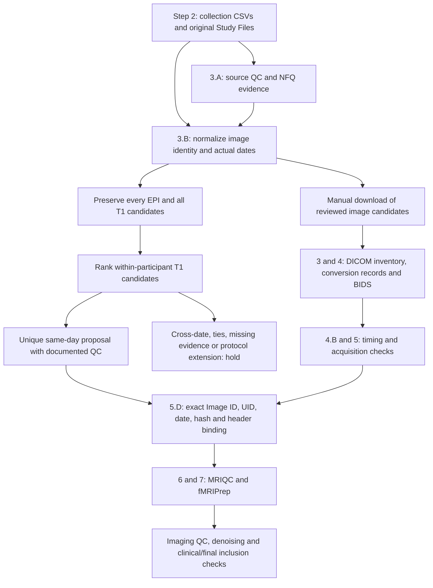

# Date-based EPI and T1 reference selection

Stage 3.B inventories images by participant, actual acquisition date, Image ID and source QC. Visit codes remain provenance. The objective is to retain the available evidence and propose an auditable anatomical reference for every EPI, before any image is approved for preprocessing.

## Workflow and decision boundaries

Metadata exports and source QC can be reviewed before a large imaging download. If images have already been downloaded, 3.B can instead reconcile that inventory. Neither route changes original source tables. The metadata stage writes only external artifacts and never invokes a downloader, Clinica, MRIQC or fMRIPrep.

The [3.B example configuration](../03_config/image_selection.example.json) accepts explicit collection files, their phases/modalities, the 3.A output directory and a new output directory. Source QC is linked through `artifact.json` and `image_qc.tsv`. Collection identity conflicts remain blocked, unverified quality remains pending, and the output receipt binds all artifacts for later verification.

## Three different dates and identities

| Evidence | Role |
|---|---|
| EPI acquisition date | The functional observation's actual imaging date |
| T1 acquisition date | The anatomy's actual imaging date; retained separately with a signed EPI–T1 gap |
| Clinical assessment date | Used later to attach clinical information to the imaging observation |
| VISCODE/visit label | Source provenance; never substituted for an acquisition date |
| Image ID and series UID | Identify the actual acquisition or delivered image, beyond its date/visit label |

The clinical nearest/28-day policy belongs to 9.A/9.B. It is not an EPI–T1 pairing window. A T1 that lacks an eligible clinical assessment can still be inventoried as an anatomical reference candidate; its image quality and registration suitability require their own assessment. Conversely, a source-QC pass does not establish clinical eligibility or final analysis readiness.

## Project policy implemented by 3.B

All supplied EPI images receive a manifest row. All supplied T1 images stay in the reference pool, including failed images marked ineligible. Links are generated only within the same participant. Known source failures cannot become eligible references, and missing source evidence is never promoted to a pass.

Eligible same-day candidates take precedence. Within that set, priority is documented source QC, Mayo-selected status, then quality grade. If no eligible same-day candidate exists, cross-date priority is documented QC, absolute acquisition-date gap, Mayo selection, then grade. Acceleration is recorded without a preference. All equally ranked top candidates are retained; the code does not break ties using Image ID, row order or the latest date.

The cross-date review window defaults to `null`, meaning all supplied dates are visible for review. A positive integer restricts the reviewed candidate set without deleting other links. Neither choice enables automatic cross-date processing. Future anatomy receives an explicit timepoint-review flag, and phase/manufacturer/scanner/field-strength differences are recorded when metadata are available. A unique proposal may therefore still require review.

This ordering is an explicit project adaptation of the documented Research selection policy. It is not claimed to be the universally optimal anatomical-reference method, an exact replay of all historical Research outputs, or a new clinical exclusion rule. The policy file records the exact choices used in each run.

## Conversion and exact binding

Clinica's ADNI converter may retain only one image for a participant/visit/modality. Its selected scan can differ from a 3.B proposal, and multiple EPI images can share a visit label. Therefore, a successfully created BIDS directory does not establish that every proposed Image ID survived conversion. [Clinica's image-selection documentation](https://aramislab.paris.inria.fr/clinica/docs/public/latest/Converters/ADNI2BIDS/).

Reconcile the source inventory with conversion records and the actual BIDS files. Step 5.D consumes `00.candidate-images.csv`, `04.epi-analysis-manifest.csv` and `07.run-manifest.json`, together with independently established Image ID/date/modality-to-NIfTI-hash evidence. It verifies exact UIDs, participant identity, dates, file hashes and headers before preparing a pair. A proposed image that is absent, ambiguous or inconsistent stays held; another scan with the same VISCODE is not a substitute.

The current guarded runner still accepts only an eligible, resolved same-day proposal in the reviewed GO/2/3 scope. Cross-date inventory does not create an executable cross-date adapter. Recovering images omitted by a converter, changing the anatomical reference mode or supporting a different phase requires a separately reviewed conversion/execution extension. Keep original dates and provenance intact.

## Evidence and its limits

| Source | Supported interpretation | What it does not establish |
|---|---|---|
| [ADNI FAQ](https://adni.loni.usc.edu/help-faqs/faqs/) | Actual EXAMDATE/VISDATE should determine longitudinal time intervals; VISCODE is phase-dependent | Equality of visit codes guarantees contemporaneous MRI acquisitions |
| [BIDS session definition](https://bids-specification.readthedocs.io/en/stable/glossary.html#session) | A session need not equal a longitudinal visit; related acquisitions from different dates may share a session | A particular cross-date T1 is biologically suitable |
| [fMRIPrep 25.2.7 workflows](https://fmriprep.org/en/25.2.7/workflows.html#longitudinal-processing) | Supports anatomical-reference construction across sessions and an independent sessionwise mode | A universal acceptable EPI–T1 date gap or permission to use future anatomy in prediction |
| [Rutherford et al. ADNI protocol preprint](https://pmc.ncbi.nlm.nih.gov/articles/PMC13692585/) | Uses actual dates for imaging/clinical alignment and describes requiring a suitable T1 from the same session in its own implementation | Validation of arbitrary cross-date references or a universal same-VISCODE rule |

Rutherford et al. is a Research Square preprint dated October 6, 2026, and has not been peer reviewed. Its clinical matching window and same-session implementation should be reported as that protocol's choices. They are distinct from the current project's 28-day clinical policy and the new metadata-only cross-date review inventory.

For prospective or predictive analyses, anatomy acquired after the target imaging timepoint may introduce information that would not have been available then. The current implementation flags such candidates and prevents automatic cross-date execution. A reviewed study design must decide which anatomy can be used, how repeated observations are handled and how biological change affects registration. Neither a calendar match nor a software-supported reference mode replaces image-quality and registration review.

## Related preprocessing and QC corrections

| Stage | Correction | Evidence and remaining judgment |
|---|---|---|
| 4.B | A conflicting series number cannot fall back to another NFQ row. UID/date evidence narrows identity when present; matching TR/slice count cannot resolve ambiguous acquisitions. Nonfinite timing is rejected. | [BIDS timing metadata](https://bids-specification.readthedocs.io/en/stable/modality-specific-files/magnetic-resonance-imaging-data.html#timing-parameters) describes timing for the actual acquired slices. Matching geometry does not prove acquisition identity. |
| 6/S8/S10 | Missing/nonfinite required IQMs or failed threshold estimates stay unresolved; a known failure still excludes. S8 reads TSV correctly and does not fill later missing FD with zero. | An unavailable measurement is not evidence of acceptable quality. The [MRIQC measures documentation](https://mriqc.readthedocs.io/en/24.0.0/measures.html) defines measurements, not permission to replace missing evidence with a pass. |
| S10 | New seeded runs use automatic initial non-steady-state removal and verify actual output frame counts. | [XCP-D 26.2.0](https://xcp-d.readthedocs.io/en/26.2.0/workflows.html) supports automatic removal from fMRIPrep flags. The 36P model does not itself remove initial transient volumes. |
| S8/S10 | Assess each reconstruction/session separately; estimate site reference from equally weighted participant medians. Small reference groups require explicit anatomical review. | [Rosen et al. (2018)](https://pubmed.ncbi.nlm.nih.gov/29278774/) supports Euler as a reconstruction-quality indicator. The retained threshold of five and configurable reference minimum of 10 are project choices, not universally validated cutoffs. |
| 7 | Retain pinned fMRIPrep 25.2.7 and exact-image input restriction. | Its [release notes](https://fmriprep.org/en/25.2.7/changes.html) document motion-parameter and mask/SDC fixes; reproducing an older protocol does not require reverting those fixes. |

The existing 36P/GSR/censoring approach has support from [Ciric et al. (2017)](https://pmc.ncbi.nlm.nih.gov/articles/PMC5483393/), but its suitability still needs cohort-level QC–FC, distance dependence, retained-duration and group-difference assessment. Current S10 FD 0.3 mm/240 s and the clinical 28-day rule are explicit adaptations, not exact reproduction of Rutherford's settings. No new claim of optimal denoising or completed cohort validation is made here.

Use a fresh runtime and the explicit `sessionwise-euler-nss-v1` configuration for these changes. The new implementation rejects old/missing policy versions before creating S10 state. Existing jobs, caches and frozen results are not migrated by this source change.

## Validation scope

Synthetic checks cover date/visit disagreement, multiple EPI runs, all-date T1 preservation, same-day and cross-date ordering, ties, future anatomy, missing/blocked QC, explicit policy limits, receipt tampering and exact BIDS handoff. This verifies code and artifact contracts. It does not process real ADNI images, validate cross-date registration, establish a research cohort or approve final inclusion. All 3.B outputs retain `PREPROCESSING_READY=False` and `ANALYSIS_READY=False`.
