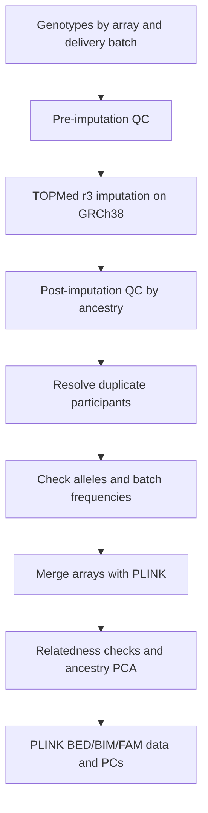

# ADNI SNP Processing

Scripts and instructions for ADNI SNP quality control, TOPMed r3 imputation and array merging, based on [Eissman et al. (2024), Methods 2.4](https://doi.org/10.1002/alz.13507). The QC code is included as a pinned [GWAS_QC submodule](01_upstream/GWAS_QC).

Local helpers plan or run individual QC stages and check source versions, job records and variant compatibility. TOPMed submission and sample review are separate steps. Review the [known code differences](06_docs/methods.md#known-code-differences) before processing a cohort.

## Workflow

Process each batch separately through post-imputation QC. Chromosome X uses a [separate workflow](06_docs/chromosome_x.md).

## Getting started

Start with the **[copy-and-paste toy walkthrough](07_toy/README.md)**. It includes public synthetic inputs, one command block per stage, fixed expected results and a comparison command. The TOPMed handoff uses an explicitly labelled offline fixture.

For your own data, use [installation and execution](06_docs/installation.md) to configure the runtime and run the upstream QC scripts. Keep research data and outputs outside this repository.

## Guides

| Guide | Contents |
|---|---|
| [Toy walkthrough](07_toy/README.md) | Runnable stages, attached inputs and result comparison |
| [Methods](06_docs/methods.md) | QC thresholds, study scope and implementation differences |
| [Installation and execution](06_docs/installation.md) | Tools, input files, configuration and TOPMed records |
| [Array merging](06_docs/merging.md) | Duplicate samples, allele checks, PLINK merge and final QC |
| [Variant check](02_custom/README.md) | Local BIM/FRQ helper and its outputs |
| [Chromosome X](06_docs/chromosome_x.md) | X-specific steps and autosomal sample handoff |
| [Versions](03_config/versions.md) · [Tests](06_docs/validation.md) | Source pin, runtime records and test scope |

Attribution: [NOTICE.md](NOTICE.md). Maintenance: [Repository instructions.md](<Repository instructions.md>).
