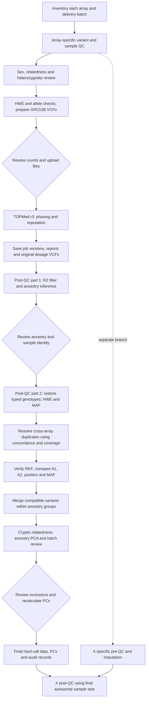

# ADNI SNP Pipeline

Contribution rules: [Repository instructions.md](<Repository instructions.md>)

This module prepares and combines ADNI array genotypes using Eissman et al. (2024), *Sex-specific genetic architecture of late-life memory performance*, as its methodological reference. It pins the research group's [GWAS_QC code](https://github.com/VUMC-VMAC/GWAS_QC/tree/5bbabfb54c2fffb86f39810386652daa124ce683) and documents an adaptation using TOPMed r3 and GRCh38.

The scope is genotype QC, imputation, array harmonization and final genetic QC. GWAS, cognitive phenotypes and imaging analyses are outside this module. The main output is a reviewed PLINK BED/BIM/FAM dataset for each ancestry analysis group. BED stores hard calls; it does not preserve continuous imputed dosage.

**Implementation status:** the upstream scripts, source checks, command planner, TOPMed record checks and variant harmonization helper are available. Containers, reference resources, real-data validation and scientific review remain necessary. The planner does not execute commands or submit data. This is not a validated end-to-end ADNI run or an exact replication of the paper's historical environment.

## Sources and reproducibility

| Source | Role |
|---|---|
| [Eissman et al., 2024, Methods 2.4](https://doi.org/10.1002/alz.13507) · [PMC full text](https://pmc.ncbi.nlm.nih.gov/articles/PMC10917043/) | Scientific reference for QC and multi-array integration |
| [VUMC-VMAC/GWAS_QC](https://github.com/VUMC-VMAC/GWAS_QC/tree/5bbabfb54c2fffb86f39810386652daa124ce683) | Unmodified upstream QC scripts, pinned as a Git submodule |
| [TOPMed getting started](https://statgen.github.io/tis-v2-docs/imputation/getting-started/) · [reference panel](https://statgen.github.io/tis-v2-docs/imputation/reference-panel/) | Current submission requirements and panel documentation |
| [Methods and differences](06_docs/methods.md) | Paper criteria, current code behavior and project adaptations |

The paper does not identify an exact GWAS_QC commit or TOPMed panel release in Methods 2.4. R2 is plausible from the publication timeline, but is unconfirmed. This repository deliberately selects r3; record the actual panel, server, phasing and imputation versions for every job. Do not combine different imputation environments.

## Workflow



The paper names Human610-Quad, HumanOmniExpress, Omni 2.5M and Global Screening Array v2. Process each array/delivery batch separately through post-imputation QC. ADNI phase and array are separate metadata fields. ADNI4 is an extension requiring delivery-specific validation; do not assign it an array or genome build from its phase label.

| Stage | Implementation | Required handoff or review |
|---|---|---|
| Inventory | Private batch configuration | Confirm array, build, sample mapping and sex metadata |
| Pre-imputation | `gwas_qc_preimputation.sh` | Review filtering logs, plots and the heterozygosity difference described below |
| Imputation | TOPMed server | Upload reviewed chromosome VCFs; save job records and reports |
| Post-imputation 1 | `gwas_qc_postimputation_part1.sh` | Review ancestry estimates and ID restoration |
| Post-imputation 2 | `gwas_qc_postimputation_part2.sh` | Supply the actual cleaned genotype stem and reviewed ancestry keep lists; defer PCs with `-p` |
| Array integration | [Merge guide](06_docs/merging.md) and [custom helper](02_custom/README.md) | Resolve duplicates, validate reference alleles, audit frequencies and merge |
| Final QC | PLINK and upstream PC tools | Review relatedness, ancestry outliers and array clustering; recalculate after exclusions |
| Optional chromosome X | [Separate X guide](06_docs/chromosome_x.md) | Apply X-specific rules and reconcile with autosomal survivors |

**Known compatibility issue:** the pinned heterozygosity helper uses SD groups whose successive assignments overwrite the extreme-outlier label. It does not implement the paper's reported p-value criterion. Resolve and validate this difference before cohort execution; a source check does not clear it. See the [code review](06_docs/methods.md#known-code-differences).

## Quick start

```sh
git submodule update --init --recursive
cd SNP
python3 04_workflow/snp.py doctor
python3 -m unittest discover -s 05_tests -v

# Store the edited configuration outside the repository.
cp 03_config/pipeline.example.json /ABSOLUTE/PATH/private-snp-config.json
python3 04_workflow/snp.py plan \
  --config /ABSOLUTE/PATH/private-snp-config.json
```

Python 3.10+ and Git are sufficient for the local helpers. Actual upstream QC requires a compatible Linux container and external references; see [installation](06_docs/installation.md). The example paths and genome builds are illustrative. A command plan does not check whether those files exist.

After pre-QC, take `cleaned_genotypes` from the reviewed log rather than guessing a long upstream suffix. After post-QC part 1, populate `ancestry_subsets` with reviewed keep-file paths. Re-run `plan` to obtain part 2 commands. Create output parent directories before executing a command, and capture stdout, stderr and the exit status in external logs. Run the stages separately in the order above.

Before merging, copy and complete one [TOPMed job record](03_config/topmed-job.example.json) per autosomal batch:

```sh
python3 04_workflow/snp.py check-jobs \
  --config /ABSOLUTE/PATH/private-snp-config.json \
  --records /ABSOLUTE/PATH/jobs/human610.json \
            /ABSOLUTE/PATH/jobs/omniexpress.json \
            /ABSOLUTE/PATH/jobs/omni25.json \
            /ABSOLUTE/PATH/jobs/gsa_v2.json
```

This checks recorded environment consistency and batch coverage. Compare the records with the original server reports separately. Keep data, identifiers, passwords, job records, reference files and execution results outside this public repository.

## Layout

```text
SNP/
├── 01_upstream/GWAS_QC/       # Unmodified, pinned submodule
├── 02_custom/                # Conservative multi-array variant audit
├── 03_config/                # Public examples and source lock
├── 04_workflow/              # Source checks and command planning
├── 05_tests/                 # Synthetic boundary and compatibility tests
└── 06_docs/                  # Methods, installation, merging and chromosome X
```

See [NOTICE.md](NOTICE.md) for attribution, [versions](03_config/versions.md) for the source pin and runtime dependencies, and the [validation record](06_docs/validation.md) for completed checks and their limits.
